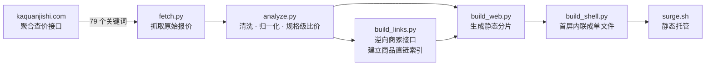

# 卡券比价站

> 跨商家卡券**规格级**比价 —— 同一个商品规格横向对比各家报价，一键跳到最低价那家的**商品页**直接下单。

[](https://github.com/BGrowl/kaquan-bijia/actions/workflows/update.yml)

**在线访问：https://kaquan-bijia.surge.sh/**

数据由 GitHub Actions 每 6 小时自动更新，**不需要任何本地机器常开**。

---

## 它解决什么问题

卡券二级市场里，同一个商品（比如「星巴克 高蛋白抹茶拿铁 PRO 中杯」）往往同时有几十家卡网在卖，价格参差不齐。聚合站能给你一堆报价，但**点进去只落到商家首页**，还得自己再搜一遍商品名——搜不到就只能一家家翻。

这个项目做两件事：

1. **规格级比价** —— 把「同一规格」的报价聚到一起，直接看有几家在售、最低价、最高价、价差多少。不是「每家最便宜那个」那种没用的榜单，而是**具体到规格**。
2. **一键直达商品页** —— 逆向了两套主流卡商系统的接口，把每条报价映射到它自己系统里的**商品详情页**。点「去下单」直接落到那个商品，不用再搜。

## 核心特性

| 特性 | 说明 |
|---|---|
| **规格级比价** | 按归一化商品名把同一规格的报价聚合，展示在售家数 / 最低 / 最高 / 价差 |
| **报价级商品直链** | 每条报价都带商家系统的商品详情页地址，覆盖约 **93%** 的报价 |
| **三级降级跳转** | 商品直链 → 站内搜索同款 → 官网首页，任何一家商家都不会跳到死链 |
| **首屏单请求** | CSS + JS + 首屏数据全部内联进 `index.html`，打开只需 **1 个请求**（gzip 约 20KB） |
| **详情页懒渲染** | 默认只列规格标签，点开哪个才生成表格，手机端 DOM 从 8000+ 降到约 1400 节点 |
| **零依赖** | 后端只用 Python 标准库（不需要 `pip install`），前端原生 JS 无框架 |

## 工作流程



一轮完整流程约 25~40 分钟，产物是一个纯静态站点（约 3.3MB，71 个按需加载的分片）。

## 目录结构

```
.
├── update.sh                       一键更新：抓取 → 构建 → 发布
├── .github/workflows/update.yml    GitHub Actions 定时任务（每 6 小时）
├── site/
│   ├── index.html                  页面骨架（构建时被内联替换）
│   ├── assets/
│   │   ├── app.js                  前端逻辑：hash 路由 · 懒渲染 · 三级跳转
│   │   └── style.css
│   └── pipeline/                   数据处理管线
│       ├── fetch.py                抓取入口 + 串联后续各步
│       ├── analyze.py              清洗、商品名归一化、按规格聚合比价
│       ├── build_links.py          建立「报价 → 商品详情页」索引（含接口缓存）
│       ├── build_web.py            生成站点分片（meta / merchants / cat）
│       ├── build_shell.py          把 css + js + 首屏数据内联成单文件
│       ├── goods_api.py            两套商家系统的适配层
│       ├── keywords.json           79 个抓取关键词
│       ├── sites.json              商家站点与站内搜索入口
│       ├── norm.py                 商品名归一化规则
│       └── fill_cache.py           按商家补全接口缓存（调试用）
└── deploy/                         早期版本的 Docker 自托管方案（见下方说明）
```

> `deploy/` 与 `site/server.py` 属于**第一版架构**（带 `/api/status` 等接口的自托管服务），
> 现已改用「纯静态站 + surge」方案，其中的文档与默认参数**未随新版更新**，参考时请注意。

## 本地运行

需要 Python 3.8+（无第三方依赖）和 Node.js（用于发布）。

```bash
git clone git@github.com:BGrowl/kaquan-bijia.git
cd kaquan-bijia

# 一条龙：抓取 → 构建 → 发布到 surge（需要 surge token）
bash update.sh

# 只想本地看效果、不发布：
export KAQUAN_WORK="$PWD/data"    # 原始抓取数据目录
export KAQUAN_DATA="$PWD/public/data"
python3 site/pipeline/fetch.py     # 抓取 + 生成分片
python3 site/pipeline/build_shell.py
python3 -m http.server 8000 -d public
```

`update.sh` 会自动探测解释器路径，也可用环境变量覆盖：

| 变量 | 用途 |
|---|---|
| `KAQUAN_PY` / `KAQUAN_NODE` / `KAQUAN_SURGE` | 指定 Python / Node / surge CLI 的路径 |
| `KAQUAN_WORK` | 原始抓取数据目录（默认 `site/pipeline/work`） |
| `KAQUAN_DATA` | 站点数据输出目录 |
| `SURGE_TOKEN` | 发布用的 surge token（也可放在 `wrapper/.surge-token`） |
| `KAQUAN_LINK_SKIP` | 跳过指定商家 id（接口不稳定的商家） |

## 云端自动更新

`.github/workflows/update.yml` 每 6 小时在 GitHub 的机器上跑一轮，**与你的电脑无关**：

- **发布通道预检** —— 先验证 `SURGE_TOKEN` 有效、源站可达，避免白跑几十分钟才失败
- **商品接口缓存** —— 用 Actions 缓存保住约 1500 个商家商品组合的接口结果，跨轮复用
- **发布结果自检** —— 发布后回查线上数据时间，确认真的更新了
- **保活提交** —— 仓库连续 60 天无提交时 GitHub 会自动停用定时任务，脚本每超过 40 天自动补一个空提交

需要在仓库 Secrets 里配置 `SURGE_TOKEN`。

## 技术要点

### 1. 两套商家系统的接口逆向

商家用的是两套不同的商城系统，各自需要不同方式拿到商品列表：

| 系统 | 商品列表接口 | 商品页 URL | 站内搜索 |
|---|---|---|---|
| 卡易信 | `POST /inside/getGoods`（`EveryPage=100`） | `/inside/buyGoods?goodId=` | `/inside/goodsList?keyWord=` |
| 卡速售 | `GET /front/goods/goods_list`（`limit=100`） | `/goods?id=` | `/category?keyword=` |

卡速售的接口需要请求头签名，算法为：

```
Sign = md5( md5( md5(SALT) + ts ) ) + ts
```

`SALT` 从前端打包产物中提取，实现在 `site/pipeline/goods_api.py`。

另外：**站内搜索的关键词必须用品牌/品类名**（如「星巴克」），用完整商品名几乎搜不到——
这也是为什么必须有「商品直链」而不能只靠站内搜索。

### 2. 前端性能

首屏曾经很慢，根因是启动时**串行请求了一个注定 404 的假接口**（等它跑完 1 秒才去加载真实数据），
加上首屏要发 6 个请求。现在改为构建期内联、首屏 1 个请求；详情页表格改为只渲染已展开的规格块。

| 指标 | 改造前 | 现在 |
|---|---|---|
| 首屏请求数 | 6 个（含 1 个阻塞 1 秒的 404） | **1 个** |
| 首屏传输量 | 约 27KB + 8KB 无用内容 | **约 20KB** |
| 进入品类详情 | 685ms / 8181 DOM 节点 | **约 150ms / 1400 节点** |

## 数据规模（单轮快照示例）

| 项目 | 数量 |
|---|---|
| 品类 | 71 |
| 商品规格 | 6180（其中 2570 个有 2 家以上可比） |
| 报价条目 | 约 18000 |
| 商家 | 38 |
| 商品直链索引 | 34 家商家 / 1293 个「商家 × 品类」组合 / 36832 条商品 |
| 静态站体积 | 3.3MB（71 个按需分片） |

## 已知限制

- **数据源是第三方聚合站**，不是商家官方接口，收录范围以对方为准（有少数品类长期为空）。
- **源站有 IP 频控**，更新间隔不能短于 6 小时，否则会被临时拒绝；因此价格是**快照**而非实时。
- **GitHub 的定时任务是「尽力而为」**：cron 走 UTC，实际触发可能有数小时延迟，偶尔会跳过一轮。
- **商品直链覆盖率约 93%**：找不到直链的报价会降级为站内搜索或官网首页。
- 少数商家的商品页需要登录才能查看，这类已降级处理。

## 免责声明

本项目仅做**价格聚合与技术演示**，不销售任何商品、不参与任何交易。

- 所有商品、价格、库存数据均来自第三方聚合站点，**不保证准确性、完整性与时效性**，请以商家页面实际显示为准。
- 商品名称、商标、品牌归各自权利人所有。
- 抓取行为遵守源站可接受的访问频率（间隔 ≥ 6 小时）；若数据源方有任何异议，请提 Issue，会立即停止抓取并移除相关内容。
- 使用本项目产生的一切后果由使用者自行承担。
